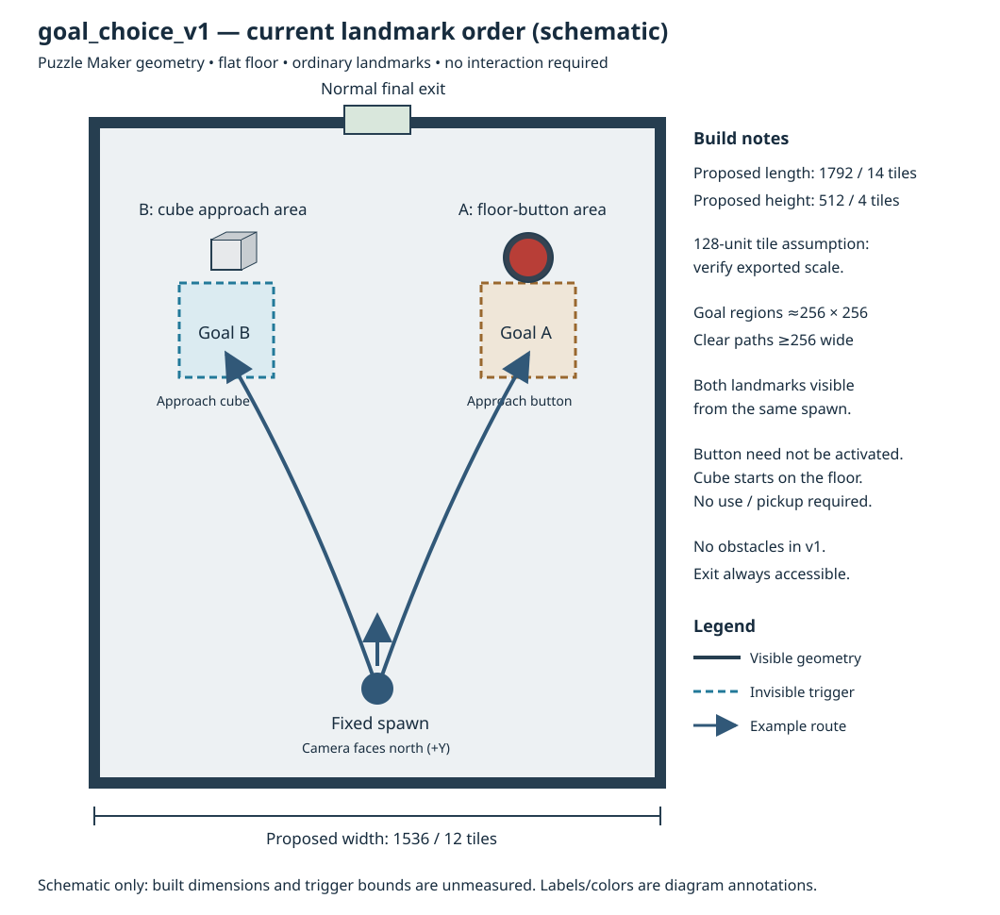

# goal_choice_v1 chamber specification

Updated 2026-11-15. The user built/compiled this chamber and hand-verified ready,
A/B, final-exit and timeout messages. This is user-reported map verification,
not automated autonomous navigation evidence. No VMF/BSP is supplied by this repo.

## Actual task and layout

One flat open room, entrance/spawn at one end and a normal final exit opposite.
**A is the RIGHT floor-button approach area; B is the LEFT cube approach area.**
Both landmarks must be visible from each registered start, with clear walking
paths. Success is first entry into the requested region. No button press, cube
pickup, portals, jump or settled-stop demonstration is required.

Use ordinary Puzzle Maker assets. The initial dimensions (1536×1792×512 units)
were a design proposal, not verified dimensions of the built map. The SVG shows
landmark order and intended trigger arrangement, not surveyed map coordinates.
Use actual map/getpos evidence to register starts and destination bounds.
The earlier pedestal/custom-symbol proposals are preserved only in the
[design archive](archive/navigation/TWO_WAYPOINT_CHAMBER_LAYOUT_HISTORY_2026_11_15.md).

## Authoring and files

Follow [chamber authoring](CHAMBER_AUTHORING.md): build geometry in Puzzle Maker,
export preview.vmf, open it in Hammer++ and Save As goal_choice_v1.vmf before
adding instrumentation. Recompile that permanent source after edits; copying a
Puzzle Maker preview BSP would discard Hammer instrumentation. Do not overwrite
other maps, frozen evaluation assets or the permanent VMF with a later preview.

Copy these files into the installed game's portal2/scripts/vscripts directory:

- `portal_assets/scripts/vscripts/shionn_events.nut`
- `portal_assets/scripts/vscripts/shionn_waypoints.nut`

Create ONE logic_script named `shionn_event_script`, with Entity Scripts set to
`shionn_events.nut shionn_waypoints.nut` in that order. Leave Entity Scripts empty
on the trigger brushes. Trigger outputs call the named logic_script.

## Working Hammer outputs

Use player-only trigger_once brushes, Clients enabled and other activation types
disabled. Apply tools/toolstrigger. Keep destination volumes on clear floor in
front of the landmarks, not over the button/cube; approximately 256×256×96 units
was proposed, but actual boundaries must be hand-verified. Ensure the player can
enter one region without entering the other or the final exit.

All rows target `shionn_event_script`, input `RunScriptCode`, Fire Once enabled:

| Brush | Output | Parameter | Delay | Expected console event |
|---|---|---|---:|---|
| shionn_start | OnStartTouch | `SignalChamberReady()` | 0 | `EVT\|chamber_ready\|<time>` |
| shionn_start | OnStartTouch | `SignalTimeout()` | 60 | `EVT\|episode_failed\|timeout` if unfinished |
| shionn_waypoint_A (right button) | OnStartTouch | `SignalWaypointA()` | 0 | `EVT\|waypoint_reached\|A` |
| shionn_waypoint_B (left cube) | OnStartTouch | `SignalWaypointB()` | 0 | `EVT\|waypoint_reached\|B` |
| shionn_final_exit | OnStartTouch | `SignalGoalReached()` | 0 | `EVT\|goal_reached\|1` |

Use the no-argument A/B functions. Quoted arguments in Hammer's output parameter
failed in the user's setup; the wrapper functions fixed the observed behavior.
Remove temporary `printl(12345)` diagnostic outputs before normal collection.

Waypoints emit nonterminal events. They must NOT call SignalGoalReached or open
the exit. Existing waypoint-aware recording distinguishes requested, wrong
waypoint, and final-exit-first outcomes. Scripts ignore waypoint events after
terminal success/failure. Reload before every attempt to reset trigger_once and
timeout state. The timeout starts at chamber-ready, including preparation time;
no timeout extension is automatic. A cube must not activate any player trigger.

## Setup, observation boundary and evidence

Two reload getpos checks matched at doorway XYZ [320,-96,64.03125], facing roughly
90° yaw. The interior_01 start [320,26.44379,64.03125] was restored and verified in
both recorded demonstrations. These are setup/evaluator coordinates, never neural
inputs. Read [registered starts](REGISTERED_STARTS.md) for current tolerance and
settling behavior; read the [fresh-pair protocol](PAIRED_VISUAL_GOAL_COLLECTION_2026_11_15.md)
for new start groups and commands. Existing pairs are exposed development-only.

The visual policy receives screenshots/history and a visually selected crop.
Persistent crop encoding, inference and source-linked sequence loading are
implemented; no visual-goal candidate has been trained. Engine positions, velocity,
trigger states, distances and puzzle relationships are not inference features.
Human crop selection demonstrates an externally requested goal, not autonomous
objective recognition. See [implementation contracts](VISUAL_GOAL_IMPLEMENTATION_2026_11_15.md).

## Future variants

Keep v1 empty. After goal-choice feasibility, separate variants may add a genuinely
blocking obstacle, unfavorable recovery starts, alternate routes to one target,
and finally a real button/cube dependency. Those variants require independent
instrumentation, labels and split review; the passive landmarks are not positive
interaction data. The [data plan](DATA_REQUIREMENTS_AND_COLLECTION_PLAN.md) defines
provisional quantities and preparation dependencies.
